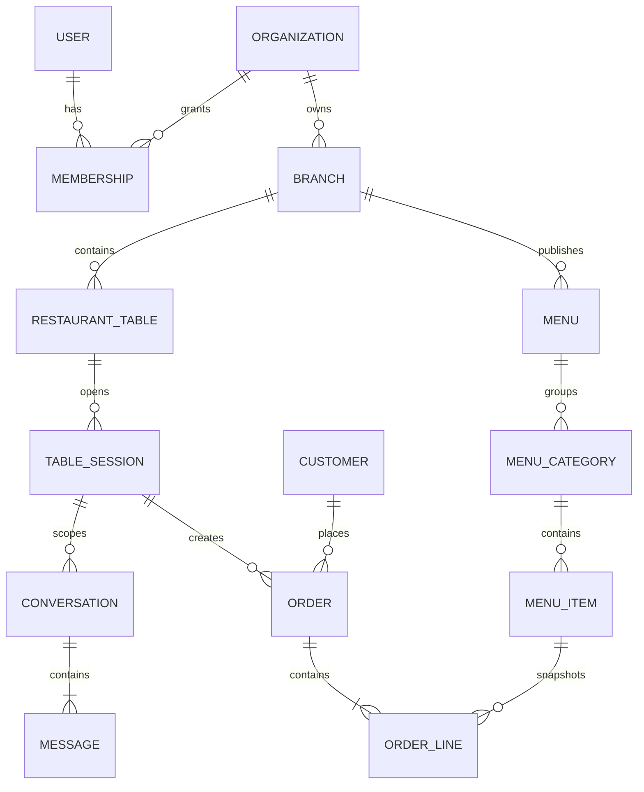

# Architecture

Baran starts as a modular monolith. This keeps transactions and delivery simple while enforcing domain boundaries that can later become services if operational evidence justifies it.

## Domain map

| Domain | Owns | Depends on |
|---|---|---|
| Identity | users, authentication | core |
| Organizations | organizations, membership, roles | identity |
| Branches | branches, staff assignment, hours | organizations |
| Tables | restaurant tables, QR tokens, table sessions | branches |
| Menus | menus, categories, items, modifiers, availability | branches |
| Customers | guest identity, profiles, preferences, retention consent | identity |
| Orders | carts, orders, lines, lifecycle | menus, tables, customers |
| Payments | payment intents, transactions, invoices | orders |
| Conversations | conversations and messages | customers, table sessions |
| AI | provider adapters and safe application tools | conversations, menus, orders |

Each domain grows `domain/`, `application/`, `infrastructure/`, and `api/` packages when complexity warrants it. Dependencies point inward: API and infrastructure call application code; application code coordinates domain objects and ports.

## Initial ERD

Order lines snapshot names, prices, tax, and chosen modifiers; history never changes when a menu changes.

## Authentication boundaries

- Staff: short-lived access tokens plus refresh rotation; membership determines organization and branch scope.
- Guests: opaque, expiring table-session token issued after resolving a non-sequential QR token.
- Customers: optional account; a guest session can be claimed after verified login.
- Super admins use a separate, audited privilege path and cannot silently inherit tenant access.

## API conventions

- Base path: `/api/v1/`
- Success: `{ "data": ..., "meta": {...} }`
- Failure: `{ "error": { "code": "...", "message": "...", "details": ... } }`
- Cursor pagination for mutable collections.
- Idempotency keys for order confirmation and payment creation.
- Optimistic concurrency/version fields for order lifecycle updates.
- UTC ISO 8601 timestamps; money as integer minor units plus ISO currency.
- Public identifiers are UUIDs/opaque tokens, never sequential database IDs.

## Phase 2 invariants

- A menu with no branch is shared by the organization; a branch menu is visible only at that branch.
- Every descendant redundantly carries `organization_id`, and write serializers reject cross-tenant relationships.
- QR lookup tokens are high-entropy, revocable, and stored only as hashes.
- Base and override prices are integer minor units; discounts cannot exceed base prices.
- Public availability is the conjunction of item activity, item availability, branch override, and positive stock when stock is tracked.
- Ingredients expose allergen metadata; options and add-ons remain deterministic catalog data for later AI tool calls.

## Phase 3 invariants

- QR tokens identify a table but are exchanged for expiring, independently revocable table-session tokens.
- A guest identity is created automatically; login remains optional and can claim the existing session.
- Cart ownership is derived only from `X-Table-Session`, never from IDs supplied in the payload.
- Prices, option deltas, add-on prices, branch stock, and menu visibility are recalculated server-side.
- Confirmation locks the session/cart, requires an organization-scoped idempotency key, and snapshots item names and all price components.
- Orders remain session-scoped for guests; possessing another order UUID grants no access.

## Phase 4 invariants

- Order status changes follow one state machine; clients cannot assign arbitrary states.
- Staff visibility is the intersection of tenant membership, branch assignment, and operational role.
- Every mutation carries the last-seen order version; stale writes fail instead of overwriting another station.
- Status changes and their actor/reason are append-only audit events.
- An outbox record is committed in the same transaction as each order event, allowing reliable WebSocket, push, email, or POS delivery later.
- Kitchen roles see only confirmed/preparing/ready work; cashiers, waiters, and managers receive role-appropriate queues and actions.

## Phase 5 AI invariants

- The provider adapter uses the Responses API but conversation persistence and domain tools are provider-independent.
- The model has no direct database access and cannot choose tenant, branch, table, customer, cart, or order identifiers.
- Function schemas are strict and the dispatcher rejects every non-allowlisted tool.
- Operational claims must originate from tool outputs; the system prompt explicitly forbids invented menu facts.
- This phase exposes read-only tools only. Cart mutation and AI ordering remain outside the model's authority.
- Tool traces and token usage are stored separately from customer-visible messages for audit and cost analysis.
- Conversation expiry follows the table session and is enforceable through a purge command.
